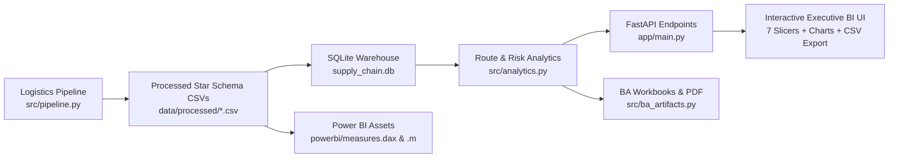
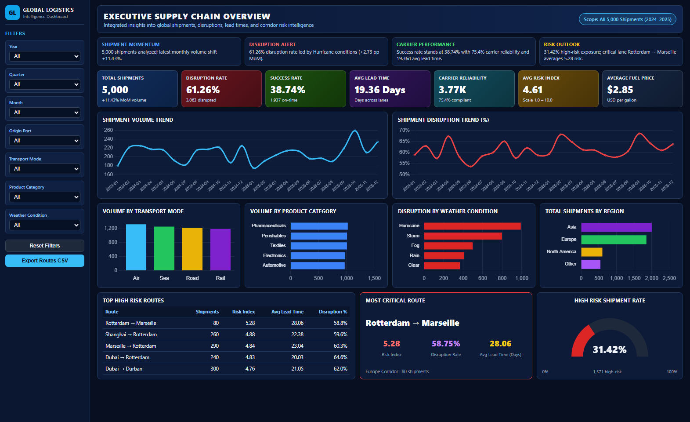
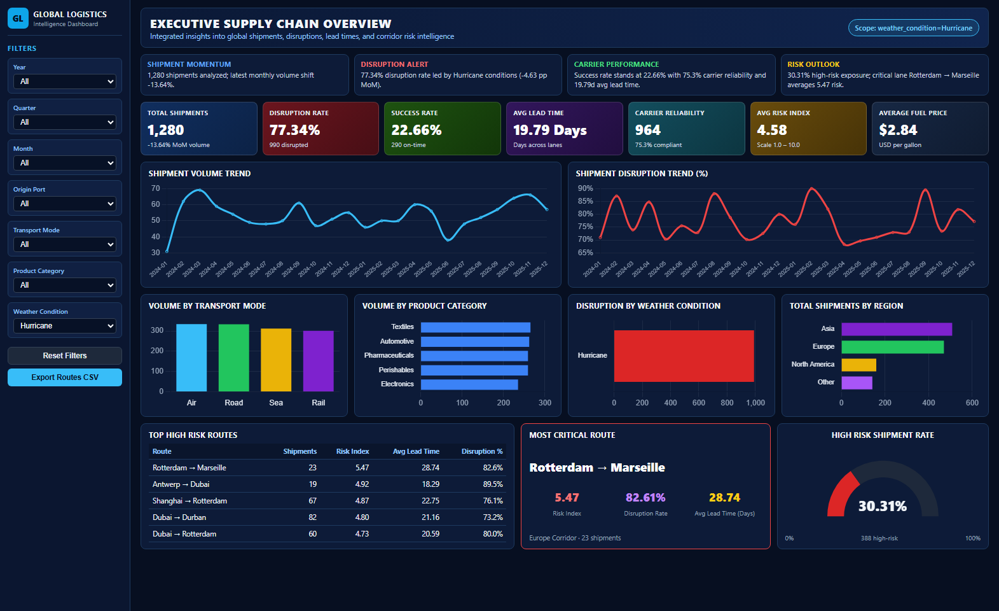

# Global Supply Chain & Logistics Intelligence

**Enterprise Business Analysis · Supply Chain Analytics · Operational Risk Intelligence**


> An end-to-end Global Supply Chain & Logistics Intelligence platform integrating multi-modal shipment tracking, disruption analytics, meteorological risk drivers, carrier reliability, lead-time diagnostics, and route-level risk scoring into a governed SQLite warehouse and interactive executive BI dashboard.

---

## 1. Executive Summary

Global supply chains face acute operational risk from severe weather events, port congestion, multi-modal lead-time variability, and elevated corridor disruption rates. When logistics operations data is siloed across carrier spreadsheets and regional exception logs, leadership lacks a consolidated view to prioritize high-risk corridors.

**Global Supply Chain & Logistics Intelligence** transforms 5,000 multi-modal shipments across 22 global trade corridors into an interactive executive intelligence environment (`FastAPI` + `Chart.js` + `SQLite`), paired with Power BI semantic layer scripts (`DAX` & `Power Query M`) and a full Business Analysis documentation suite.

- **Intended Users:** Chief Supply Chain Officer, Logistics & Operations Directors, Risk Management Leads, Carrier Procurement Teams, and Business/Data Analysts.
- **Data Disclosure:** Built on a deterministic, calibrated 5,000-shipment synthetic benchmark dataset (2024–2025) modeled to preserve strict mathematical KPI reconciliation across modes, regions, weather conditions, and routes.

---

## 2. Business Problem Statement

Without centralized logistics intelligence, operations leaders face recurring blind spots:

| Operational Metric | Observed Benchmark Value | Analytical Significance |
| :--- | :--- | :--- |
| **Total Shipments** | `5,000` | Multi-modal baseline (Air, Sea, Road, Rail) |
| **Shipment Disruption Rate** | `61.26%` (`3,063` shipments) | Substantial operational exposure requiring exception governance |
| **Shipment Success Rate** | `38.74%` (`1,937` shipments) | Mathematically complementary (`Disruption + Success = 100%`) |
| **Average Lead Time** | `19.36 Days` | Multi-corridor delivery duration baseline |
| **Carrier Reliability** | `3.77K` (`75.4%`) | Carrier SLA compliance benchmark |
| **Average Risk Index** | `4.61` (1–10 scale) | Portfolio-wide corridor risk intensity |
| **High-Risk Shipment Rate** | `31.42%` (`1,571` shipments) | Nearly one-third of volume exposed to elevated risk |
| **Average Fuel Price** | `$2.85 / gal` | Freight cost baseline across reporting horizon |
| **Most Critical Corridor** | `Rotterdam → Marseille` | Ranked #1 risk (`5.28`) and lead time (`28.06` days) |

---

## 3. Project Objectives

- **BO-01 (Shipment Visibility):** Consolidate volume trends, transport modes, product categories, and regional exposure into a unified reporting layer.
- **BO-02 (Disruption Diagnostics):** Quantify disruption drivers led by severe weather (`Hurricane`: 990, `Storm`: 797, `Fog`: 498, `Rain`: 410, `Clear`: 368).
- **BO-03 (Transportation Performance):** Benchmark lead times, carrier reliability, and success rates across Air, Sea, Road, and Rail.
- **BO-04 (Route Risk Intelligence):** Rank critical corridors (`Rotterdam → Marseille`, `Shanghai → Rotterdam`, Antwerp lanes) to guide mitigation.
- **BO-05 (Governed Executive KPIs):** Eliminate contradictory reporting narratives through SQL/DAX metric parity and dynamic insight synchronization.

---

## 4. Proposed Solution

1. **Star Schema Logistics Warehouse (`sql/schema.sql`, `src/pipeline.py`):** Normalizes shipments into `dim_date`, `dim_route`, `dim_carrier`, `dim_product_category`, `dim_weather`, and `fact_shipments`.
2. **Dynamic Analytics & Route-Risk Engine (`src/analytics.py`):** Computes real-time filtered KPIs, Month-over-Month shifts, weather/mode/region breakdowns, and critical-route ranking.
3. **Interactive Dark-Executive BI Dashboard (`app/`):** Features a 7-slicer sidebar (`Year`, `Quarter`, `Month`, `Origin Port`, `Transport Mode`, `Product Category`, `Weather Condition`), 4 dynamically synchronized executive insight callouts, 7 KPI tiles, 6 interactive charts, a sortable High-Risk Routes table, a Most Critical Route spotlight, and a High-Risk radial gauge.
4. **Power BI & BA Governance Deliverables (`powerbi/`, `docs/business-analysis/`):** Includes `measures.dax`, `power_query.m`, star-schema ERD, `BRD`, `Stakeholder & RACI`, `AS-IS/TO-BE Process Maps`, Excel `RTM` & `UAT` workbooks, and ReportLab executive PDF.

---

## 5. Methodology & Implementation Approach

- **AS-IS Workflow:** `Plan Shipment → Assign Transport → Execute Delivery → Handle Exceptions → Report Results` (disconnected exception trackers, inconsistent definitions).
- **TO-BE Workflow:** `Capture Events → Validate Data → Assess Risk → Prioritize Response → Monitor Outcomes`.
- **Reconciliation Controls:** Enforces strict mathematical invariants (`Disrupted + Successful == Total Shipments`), corrects legacy spelling errors (`DISTRUPTION` → `DISRUPTION`), and binds top insight cards dynamically to SQL outputs so narrative insights never contradict KPI cards.

---

## 6. Key Features & Capabilities

- **7-Dimensional Interactive Filtering:** Filter instantly by Year, Quarter, Month, Origin Port, Transport Mode, Product Category, and Weather Condition.
- **Dynamic Executive Insight Cards:** Shipment Momentum, Disruption Alert, Carrier Performance, and Risk Outlook update automatically per slice.
- **Corridor Risk Ranking & Spotlight:** Identifies top high-risk lanes and surfaces `Rotterdam → Marseille` critical corridor metrics.
- **Weather Impact Decomposition:** Isolates Hurricane, Storm, Fog, Rain, and Clear disruption concentrations.
- **CSV Export & Input Validation:** One-click route risk CSV download (`/api/export/routes-csv`) and HTTP 400 validation for invalid filter inputs.

---

## 7. Technology Stack

| Layer | Technologies Used |
| :--- | :--- |
| **Backend & API** | Python 3.13, FastAPI, Uvicorn, Pydantic |
| **Data & Analytics** | SQLite (`sqlite3`), Pandas, NumPy |
| **Interactive Frontend** | HTML5, CSS3, Vanilla JavaScript, Chart.js 4.4.7 (vendored) |
| **BI Semantic Layer** | Power BI DAX (`measures.dax`), Power Query M (`power_query.m`) |
| **BA Deliverables & QA** | OpenPyXL (`.xlsx`), ReportLab (`.pdf`), Mermaid, Pytest, HTTPX |

---

## 8. Architecture & Workflow



---

## 9. Project Structure

```text
global-supply-chain-logistics-intelligence/
├── app/
│   ├── main.py                      # FastAPI web & REST/CSV routes
│   ├── static/
│   │   ├── css/dashboard.css        # Deep navy executive logistics styling
│   │   ├── js/dashboard.js          # Dynamic charts, tables & insight synchronization
│   │   └── vendor/chart.umd.min.js  # Bundled Chart.js library
│   └── templates/index.html         # 7-slicer layout & KPI/chart panels
├── assets/screenshots/              # Genuine rendered dashboard screenshots
├── data/processed/                  # Normalized star schema CSV tables
├── docs/business-analysis/          # 8 BA docs + rtm_workbook.xlsx + uat_test_log.xlsx + PDF
├── powerbi/                         # data_model.md, measures.dax, power_query.m
├── sql/                             # schema.sql, analytics_queries.sql
├── src/                             # config.py, pipeline.py, analytics.py, ba_artifacts.py
├── tests/test_project.py            # Automated reconciliation & API test suite
├── pytest.ini
├── requirements.txt
└── run.py
```

---

## 10. Installation & Setup

```bash
git clone https://github.com/abrahamnewwine-web/global-supply-chain-logistics-intelligence.git
cd global-supply-chain-logistics-intelligence
python -m venv .venv
# Windows: .venv\Scripts\activate | macOS/Linux: source .venv/bin/activate
pip install -r requirements.txt
```

---

## 11. Usage Instructions

```bash
# Build warehouse & BA deliverables only
python run.py --build-only

# Start interactive executive dashboard (default port 8002)
python run.py --port 8002

# Execute automated verification tests
pytest -v
```

---

## 12. Screenshots & Visual Documentation

### Executive Supply Chain Overview (All 5,000 Shipments)


### Interactive Weather Filter (`Weather Condition = Hurricane`)


---

## 13. Video Demonstration

Video Demonstration: Coming Soon.

---

## 14. Deliverables

- **SQL & ETL Warehouse:** [`sql/schema.sql`](sql/schema.sql), [`sql/analytics_queries.sql`](sql/analytics_queries.sql), [`src/pipeline.py`](src/pipeline.py)
- **Interactive Dashboard App:** [`app/main.py`](app/main.py), [`app/templates/index.html`](app/templates/index.html)
- **Power BI Developer Kit:** [`powerbi/data_model.md`](powerbi/data_model.md), [`powerbi/measures.dax`](powerbi/measures.dax), [`powerbi/power_query.m`](powerbi/power_query.m)
- **Business Analysis Suite:**
  - [01 — Business Case](docs/business-analysis/01-business-case.md)
  - [02 — Business Requirements Document](docs/business-analysis/02-brd.md)
  - [03 — Stakeholder Analysis & RACI](docs/business-analysis/03-stakeholder-raci.md)
  - [04 — AS-IS / TO-BE Process Maps](docs/business-analysis/04-process-mapping-gap-analysis.md)
  - [05 — RTM](docs/business-analysis/05-requirements-traceability-matrix.md) & [`rtm_workbook.xlsx`](docs/business-analysis/rtm_workbook.xlsx)
  - [06 — Agile Epics & Stories](docs/business-analysis/06-agile-epics-user-stories.md)
  - [07 — UAT Test Plan & Defect Log](docs/business-analysis/07-uat-test-plan-and-defect-log.md) & [`uat_test_log.xlsx`](docs/business-analysis/uat_test_log.xlsx)
  - [08 — Executive Insights](docs/business-analysis/08-executive-insights-recommendations.md) & [`executive_insights_report.pdf`](docs/business-analysis/executive_insights_report.pdf)

---

## 15. Business Value & Impact

- **Observed Analytical Value:** Replaces fragmented exception spreadsheets with unified visibility into `61.26%` disruption exposure, `31.42%` high-risk volume, weather drivers, and corridor bottlenecks led by `Rotterdam → Marseille`.
- **Expected Operational Benefits (Requires Live Adoption):** Integrating early-warning weather alerts, prioritizing carrier diversification on high-risk European/Asian lanes, and standardizing KPI governance are expected to reduce schedule variability and expedite disruption recovery once connected to live TMS workflows.

---

## 16. Testing & Validation

All 6 pytest cases pass cleanly (`pytest -v`), validating:
- Exact 5,000-shipment star-schema integrity with zero orphan foreign keys
- `Disruption Rate + Success Rate == 100.0%` reconciliation
- Exact sum of weather disruptions (`3,063`), modes (`5,000`), categories (`5,000`), and regions (`5,000`)
- Critical corridor ranking (`Rotterdam → Marseille`)
- API HTTP 200/400 validation, CSV export structure, and Excel/PDF generation

---

## 17. Limitations & Future Enhancements

- **Simulated Portfolio Dataset:** Benchmark data models global supply chain patterns rather than live carrier EDI feeds.
- **Future Enhancements:** Real-time AIS vessel tracking integration, NOAA/ECMWF severe weather API ingestion, and automated carrier SLA alerting.

---

## 18. Author Information

**Abraham Adetola** — *PMP® | PMI-PBA® | CSPO® | CSM®*  
Business Intelligence & Business Analyst Professional · Atlanta, Georgia, USA  
Email: [abrahamnewwine@gmail.com](mailto:abrahamnewwine@gmail.com)
