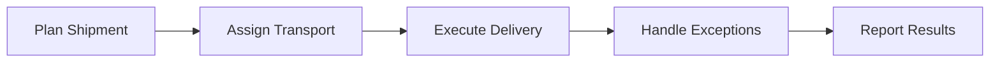
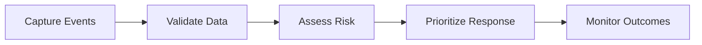

# AS-IS / TO-BE Process Mapping & Gap Analysis — Global Supply Chain & Logistics Intelligence

## AS-IS: Current-State Shipment Management

*Challenges:* Separate exception tracking across ports/carriers, inconsistent KPI definitions, and reactive escalation.

## TO-BE: Future-State Logistics Intelligence

*Improvements:* Unified star schema, standardized disruption/success/high-risk rules, and interactive route-risk prioritization.
